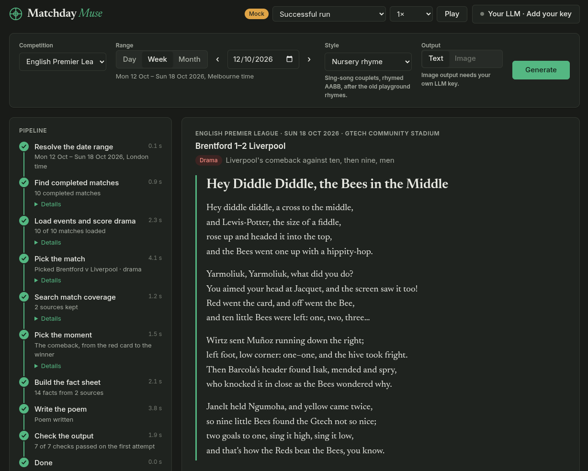

# Matchday Muse
Matchday Muse (working title) picks the most dramatic or funny moment from recent sport and retells it as a short rhyming poem (a ballad, a sonnet, limericks and so on), or optionally an image. It is an educational project that exercises MCP, LLM tool use, guardrails, evals, IaC and observability.

## Current status



*The UI replaying a scripted run (`?mock=success`) in dark mode.*

**Phase 0**, a walking skeleton ([roadmap](docs/design.md#build-roadmap)).

- **Done:**
  - the WebSocket and pipeline contracts;
  - the Angular UI (shown above), with the reveal, "Show your working" and retelling;
  - the Go MCP server, serving Premier League matches from ESPN;
  - the FastAPI backend, running every stage on real match data;
  - all of it in docker compose.
- **Pending:**
  - **The LLM stages, through LiteLLM.** Until then a mock stands in, so a real run's "poem" is the key moments' facts, not verse; the poem above is a hand-written sample.
  - **The guardrail checks.** They currently show as skipped.
  - **A golden set of past weeks and a baseline eval.**

## Try it

The stack runs in Podman or Docker, with Compose (`docker-compose`, which `podman compose` uses too); the tests run on the host and need Node 22.22, 24.15 or 26 and later (what Angular 22 supports), Go 1.25 or later, and [uv](https://docs.astral.sh/uv/) (Python 3.14).

```sh
make dev            # compose: the UI at http://localhost:4200 on the real backend
                    # (localhost:8000) and MCP server (localhost:8081/mcp)
make down           # stop the stack
make dev-mcp        # MCP Inspector on the Go server over stdio, no Docker needed
make test           # contract checks, Go, backend and frontend tests, offline
```

`make dev` creates `.env` from [.env.example](.env.example) with a fresh `MCP_AUTH_TOKEN` the first time. While it runs, frontend changes hot-reload and Go changes restart the server, which recompiles in a couple of seconds. After changing dependencies, rerun `make dev`. `make images` builds the deployable images.

The poem is a placeholder until the LLM stages land: the mock writer lines up the moment's facts and says so. To replay a scripted run instead of the backend, open `?mock=<script>`, for example `?mock=guardrail-failed&speed=0`; the scripts are in [contracts/ws/examples/](contracts/ws/examples/). See also [backend/README.md](backend/README.md) and [mcp-server/README.md](mcp-server/README.md).

## How it works

1. A Go MCP server fetches every completed match in the chosen week, with its play-by-play.
2. The pipeline scores each match for drama (late goals, lead changes, red cards), and an LLM picks the best one, searching web coverage of a short list for funny or controversial angles.
3. A grounded fact sheet is built from the match events and coverage, and the poem is written from that fact sheet only, in a rhyming form such as a ballad, a sonnet or limericks.
4. Guardrails check the score, names, quotes, copying and grounding before anything is shown.

## Planned stack

| Part | Technology |
| --- | --- |
| Sports data and search | Go MCP server (official Go SDK); ESPN, Exa or Tavily |
| Pipeline and API | Python, FastAPI, Pydantic v2, LiteLLM, Postgres |
| Frontend | Angular, WebSockets |
| Evals | Inspect, pytest, `go test`; promptfoo later |
| Deployment | Docker images and docker compose locally; Terraform on GCP later |

## Documentation

- [Design document](docs/design.md): architecture, pipeline, guardrails, evals and roadmap.
- [TODO](TODO.md): planned work not yet scheduled into a phase.

## License

[MIT](LICENSE)
