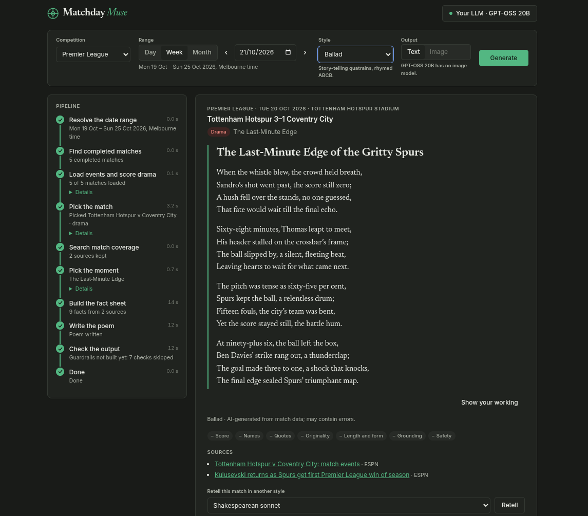
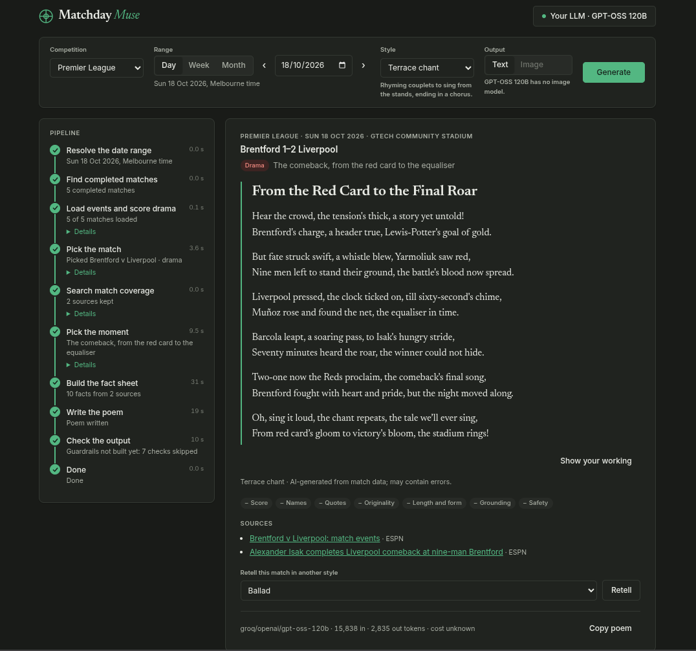
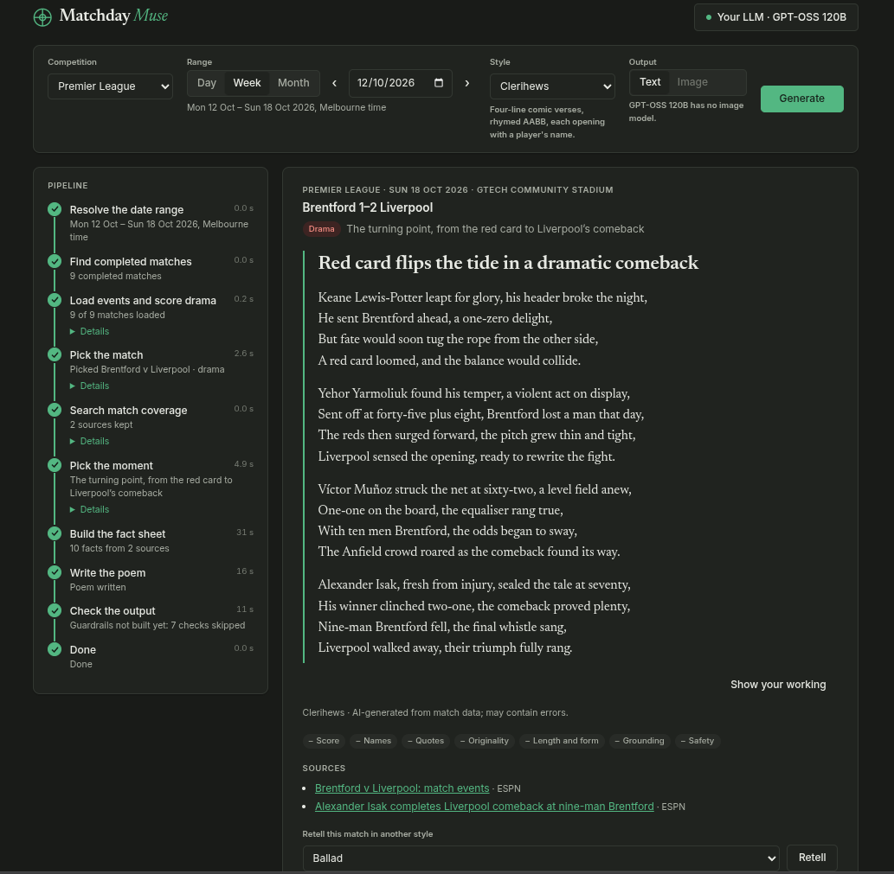

#  Matchday Muse
Matchday Muse (working title) picks the most dramatic or funny moment from recent sport and retells it as a short rhyming poem (a ballad, a sonnet, limericks and so on), or optionally an image. It is an educational project that exercises MCP, LLM tool use, guardrails, evals, IaC and observability.

## Current status

Real runs on live Premier League data, written by GPT-OSS on Groq's free tier. They were captured just before the guardrails landed, so their check chips show as skipped (and the header still has the old placeholder logo).



*The week of 19 Oct as a ballad (GPT-OSS 20B): five completed matches loaded and scored, Tottenham 3–1 Coventry picked for its drama, and a poem built around Ben Davies' stoppage-time goal.*



*A single day as a terrace chant (GPT-OSS 120B), with tokens and model in the footer. Its "nine men left" after Brentford's first red card is a false claim (they had ten); catching that kind of rhyme-driven error is what the grounding check now does.*



*The week of 12 Oct as clerihews (GPT-OSS 120B): nine matches scored, the same comeback picked, each verse opening with a player's name.*

**Phase 0**, a walking skeleton ([roadmap](docs/design.md#build-roadmap)).

- **Done:**
  - the WebSocket and pipeline contracts;
  - the Angular UI (shown above), with the reveal, "Show your working" and retelling;
  - the Go MCP server, serving Premier League matches from ESPN;
  - the FastAPI backend, running every stage on real match data;
  - the LLM stages through LiteLLM: picking the match (with coverage searches), the moment, the fact sheet, the poem, and the grounding judge behind Show your working, on your own Gemini, Groq, Anthropic or OpenAI key;
  - the guardrails: every poem's scores, names, quotes, originality, length and form, and grounding are checked; a failing poem gets one rewrite, and if it fails again it is not shown;
  - all of it in docker compose.
- **Pending:**
  - **The moderation check**, in Phase 1 (its chip shows as skipped).
  - **A golden set of past weeks and a baseline eval.**

## Try it

The stack runs in Podman or Docker, with Compose (`docker-compose`, which `podman compose` uses too). Nothing else is needed to run it:

```sh
docker compose up -d     # or: podman compose up -d
```

Then open http://localhost:4200. The first start builds the images and takes a few minutes; `docker compose down` stops it. Add `--build` after changing dependencies.

For development, the tests run on the host and need Node 22.22, 24.15 or 26 and later (what Angular 22 supports), Go 1.25 or later, and [uv](https://docs.astral.sh/uv/) (Python 3.14):

```sh
make dev            # compose: the UI at http://localhost:4200 on the real backend
                    # (localhost:8000) and MCP server (localhost:8081/mcp)
make down           # stop the stack
make dev-mcp        # MCP Inspector on the Go server over stdio, no Docker needed
make test           # contract checks, Go, backend and frontend tests, offline
```

No `.env` is needed: compose generates the token the backend and MCP server share. To change settings, copy [.env.example](.env.example) to `.env`. Frontend and backend changes reload in either mode; Go changes restart the server under `make dev` (which runs `compose up --build --watch`), or after `docker compose restart mcp-server`, and it recompiles in a couple of seconds. After changing dependencies, rerun `make dev`. `make images` builds the deployable images.

To run it in production, on a server behind a tunnel or reverse proxy on the same host, clone the repo there, set `ALLOWED_ORIGINS` in `.env` to the site's address (for example `https://matchday-muse.example.com`), then:

```sh
./deploy.sh         # pull, rebuild, restart, and wait until the site answers; again for every redeploy
```

`deploy.sh` needs no make; it refuses to run with local changes to tracked files, and warns if the development stack is still running or the stack would not survive a reboot. With make, `make prod` starts the same stack (`compose.prod.yaml`: the built UI and /ws on 127.0.0.1:8080, or `APP_PORT`), `make prod-down` stops it and `make prod-logs` follows the logs.

Point the tunnel or proxy at `http://localhost:8080`. Only the backend publishes a port, on localhost; the MCP server stays on the compose network. There is no server LLM key in production, so every visitor adds their own. Containers restart on failure and after a reboot; on Podman, enable `podman-restart.service` for the reboot part (for rootless Podman: `systemctl --user enable podman-restart.service` and `loginctl enable-linger`).

Without a key, the production build (`make prod`) plays a sample run: the week of 12 Oct 2026, with a poem written in advance in every form. To write a poem, add your key under **Your LLM** in the top right (free Gemini and Groq keys work). Keys stay in the browser tab's session storage and travel only with each run. Set `MOCK_LLM=true` in `.env` to run without a key: a mock then lines up the moment's facts instead of verse. To replay a scripted run instead of the backend, open `?mock=<script>`, for example `?mock=guardrail-failed&speed=0`; the scripts are in [contracts/ws/examples/](contracts/ws/examples/). See also [backend/README.md](backend/README.md) and [mcp-server/README.md](mcp-server/README.md).

## Guardrail thresholds

Every poem must pass these before it is shown (see the Guardrails section of the [design doc](docs/design.md#guardrails)). They are judgement calls, to be calibrated on the golden set:

| Check | Threshold | Why |
| --- | --- | --- |
| Length | Headline ≤ 10 words; poem 8–30 lines, ≤ 300 words | Keeps the result card readable on a phone |
| Form | Sonnet 14 lines, villanelle 19, 5 lines per limerick, 4 per clerihew | The only craft rules enforced: cheap to check, and a "sonnet" of 12 lines is plainly wrong. Metre and rhyme are scored by evals |
| Originality | No run of more than 10 words, and at most 5% of 8-word phrases, shared with the coverage | Long enough to allow stock phrases and names, short enough to stop copying a report |
| Quotes | At most 1, of at most 25 words, word for word from a quote fact | Real people's words must be exact and sparing |
| Score | Only scores the match passed through (or 0–0), in any order | Intermediate scores tell the story; a score that never happened is a false claim |

## How it works

1. A Go MCP server fetches every completed match in the chosen week, with its play-by-play.
2. The pipeline scores each match for drama (late goals, lead changes, red cards), and an LLM picks the best one, searching web coverage of a short list for funny or controversial angles.
3. A grounded fact sheet is built from the match events and coverage, and the poem is written from that fact sheet only, in a rhyming form such as a ballad, a sonnet or limericks.
4. Guardrails check the score, names, quotes, copying and grounding before anything is shown.

## Stack

| Part | Technology | Status |
| --- | --- | --- |
| Sports data and search | Go 1.25+, official MCP Go SDK, go-resty; ESPN; offline fixture search | Built; Exa and Tavily in Phase 1 |
| Pipeline and API | Python 3.14 (uv), FastAPI, Pydantic v2, the MCP Python SDK, LiteLLM | Built; Postgres in Phase 1 |
| LLM providers | Gemini, Groq, Anthropic, OpenAI, your own key | Built |
| Frontend | Angular 22 (signals, zoneless), WebSockets | Built |
| Evals | pytest, `go test`, Vitest; Inspect for LLM evals; promptfoo later | Unit and protocol tests built; Inspect next |
| Deployment | Docker images and compose on Podman or Docker; Terraform on GCP later | Local stack built |

## Documentation

- [Design document](docs/design.md): architecture, pipeline, guardrails, evals, roadmap and the decision log.
- [Changelog](CHANGELOG.md): what each commit delivered.
- [TODO](TODO.md): planned work not yet scheduled into a phase.
- [Backend](backend/README.md), [MCP server](mcp-server/README.md) and [frontend](frontend/README.md) READMEs: running and testing each part.
- [AGENTS.md](AGENTS.md): rules for coding agents working in this repo.

## License

[MIT](LICENSE)
