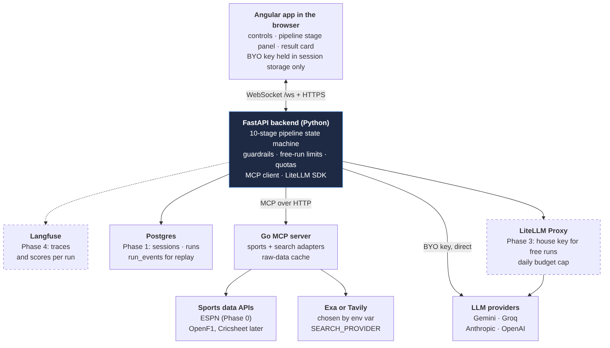

# Matchday Muse — Design Document

Oct 19, 2026 · @Sathwik

## Overview

Matchday Muse (working title) picks the most dramatic or funny moment from recent sport and retells it as a short rhyming poem (a headline and 8 to 30 lines, in a form such as a ballad, a sonnet or limericks), or optionally an image. It is an educational project that exercises MCP, LLM tool use, guardrails, evals, IaC and observability.

A user picks a sport and league (default: Football, English Premier League), a date range (default: the current week) and a style. The system then:

1. Fetches every completed match in the range, with its play-by-play, from a Go MCP server.
2. Computes deterministic drama signals per match (late goals, lead changes, red cards), then lets an LLM choose the most promising match, checking web coverage of a short list through tool calls.
3. Fetches web coverage for the picked match.
4. Builds a grounded fact sheet, then writes the poem (or image) in the chosen form.
5. Checks the output with guardrails before showing it, streaming every stage to the browser over WebSockets.

**Learning and resume goals:** build an MCP server in Go; orchestrate LLM calls with structured outputs and tool calling; support multiple LLM providers via LiteLLM; implement guardrails; measure quality with evals; deploy with Terraform; add tracing later.

**Walking skeleton (Phase 0):** the whole product end to end, thinly. The Angular UI comes first, built against mock WebSocket runs replayed from contract examples, so the screens and the protocol are settled before any backend exists. Then the real pieces replace the mock one by one: a FastAPI WebSocket endpoint, the Go MCP server, the Python pipeline with core guardrails, your own key from the settings drawer, and a baseline Inspect eval. The stack runs in docker compose from the start, so each service gets its image as it lands; no database yet. This covers MCP, tool calling, structured output, guardrails, evals and the UI.

**MVP scope (Phase 1):** EPL only via the ESPN adapter; text only; paste-your-own-key; Exa or Tavily search; WebSocket stage streaming; Angular UI; docker-compose locally; the full guardrail set; Go tests, pytest and an Inspect eval that meets its targets.

**Later phases:** F1 and cricket adapters, images and OpenRouter OAuth (Phase 2); Terraform on GCP, the house key with 3 free runs, run resume and promptfoo red-teaming in CI (Phase 3); the shared result cache, Langfuse, AFL and UFC adapters and drama-signal weights tuned once pick quality is measured (Phase 4). See Build roadmap; parked work is in [TODO.md](../TODO.md).

## Critique and key decisions

The concept is sound, but the scope has grown from a one-day build into several weeks of evenings; Phase 1 alone is more than two weeks. Ship the Phase 0 walking skeleton first, then layer on the rest; every later phase plugs into seams Phase 0 already defines.

**Issues found and how this design handles them**

| Issue | Risk | Decision |
| --- | --- | --- |
| Scope creep | Nothing ships; half-built everything | Phase 0 is a walking skeleton: UI first against mocks, then a thin real pipeline behind it, no database; Phase 1 is EPL and text only; the house key and free runs wait for the public deployment in Phase 3 |
| Agent-driven code drifts across Go, Python and TypeScript | Mismatched JSON shapes between services | Contracts first: Go structs own the MCP tool schemas (the Go SDK infers them) and are exported to `contracts/mcp/`; WebSocket and pipeline schemas are hand-written JSON Schema; all generated into each language |
| Picking from final scores only | Late winners, VAR drama and funny moments are invisible; the comedy angle almost never wins | Fetch events for every candidate (cheap, cached), compute deterministic drama signals, and let `pick_match` search coverage for a short list |
| The core feature goes unmeasured | Evals score grounding and style but never whether the pick was good | Parked for now (see [TODO.md](../TODO.md)); the golden set is already built from whole weeks so pick metrics can be added without re-freezing data |
| Deterministic output checks on stylised verse | "Zeus", "thrice to twice" and verbatim quotes trip the checks; most runs fail after one repair | Person-entity matching with name variants and per-style allowlists; score parser with number words; attributed quotes verified rather than penalised |
| Rhyming forms | Rhyme pressure bends facts and names to fit ("scored with heft" is colour, "scored a hat-trick" to rhyme with "trick" is a false claim); rhyme detectors fail on names like "Yarmoliuk" | Grounding and name checks apply to every line as usual, and the repair prompt names the line; rhyme and metre are eval metrics, never guardrails; rhyme detection falls back to spelling for names the pronouncing dictionary lacks |
| Free-text style prompts | Prompt injection, living-artist imitation, unscoreable evals | Curated style presets in Phase 1; free text later, behind moderation |
| Web pages fed to the LLM | Indirect prompt injection from search results | Retrieved text is data: delimited, truncated, never given tool access |
| WebSocket runs on Cloud Run | With request-based billing, CPU is throttled once the socket closes, so a "background" run stalls | Instance-based billing (CPU always allocated) with max instances = 1 in Phase 3; stage events persist in Postgres so a reconnecting client can replay them; runs interrupted by a restart are marked failed on startup |
| Go MCP server in the cloud | stdio does not work across containers | Support both transports: stdio for local tools, Streamable HTTP in containers; never public |
| BYO keys pass through the backend | Keys leak into logs or traces | Keys live only in browser session storage and request memory; redaction in logs, LiteLLM callbacks and (later) Langfuse |
| Evals hit live APIs | Flaky, non-reproducible scores, quota burn | Record and replay fixtures; the Go server's raw-data cache freezes golden-set inputs |
| Self-hosting Langfuse | Langfuse needs ClickHouse, Redis, Postgres and blob storage | Use the Langfuse Cloud free Hobby tier |
| IaC for local hosting | Terraform's Docker provider adds little over compose | docker-compose locally; Terraform for the cloud only |

**Assumptions to confirm**

- Cloud: **GCP** (Cloud Run, Cloud SQL, Cloud Storage, Secret Manager). Cloud Run scales to zero and supports WebSockets, which keeps a hobby deployment cheap. An AWS mapping is in Infrastructure.
- House model: a cheap Flash- or Haiku-class model.
- Search default: Exa, with Tavily selectable by environment variable.

**Tool facts checked for this design**

- OpenAI announced its acquisition of promptfoo on 9 March 2026; the founders said the open-source tooling stays available and keeps supporting non-OpenAI models ([source](https://finance.yahoo.com/news/openai-acquires-promptfoo-secure-ai-174904138.html); primary: OpenAI's announcement post). Treat it as a useful add-on, not the eval backbone.
- Langfuse Cloud's Hobby tier is free at 50k units a month for 2 users; self-hosting is MIT-licensed but runs web, worker, ClickHouse, Postgres, Redis and blob storage ([source](https://langfuse.com/resources/engineering/clarifications.md)).

## Concepts primer

Each term below is something this project builds or uses; read this first if any of them are new.

| Concept | What it is | Where it appears here |
| --- | --- | --- |
| MCP (Model Context Protocol) | A standard way to expose tools and data to LLM apps. A server lists tools with JSON input schemas; any MCP client can call them. | The Go server exposes sports-data and search tools; the Python backend is its client. Claude Desktop or MCP Inspector can call it too. |
| Tool calling | The LLM replies with a structured request to call a named function; your code runs it and returns the result. | `pick_match` calls `search_coverage` on up to 3 short-listed matches to find funny or controversial angles before choosing. |
| Structured output | Forcing the LLM to reply in JSON that matches a schema, then validating it. | Match pick, moment pick and the fact sheet are Pydantic models. |
| LiteLLM | A Python library and proxy that gives one API over 100+ LLM providers. | The SDK calls a user's own key; the proxy holds the house key with a budget. |
| Grounding | Every factual claim in the output traces back to retrieved data. | The fact sheet is the only source the writer may use; a judge checks it. |
| Guardrails | Runtime checks that block or repair bad inputs and outputs, on every request. | Input validation, injection defences, score check, overlap check, moderation. |
| Evals | Offline tests that measure quality over a fixed dataset, run before shipping a change. | Golden set of hand-labelled weeks scored with Inspect, pytest and later promptfoo. |
| LLM-as-judge | Using a model to grade another model's output against a rubric. | Grounding and style-adherence scores; calibrated against your own labels. |
| WebSockets | A long-lived two-way connection between browser and server. | Streams pipeline stages; carries cancel and mid-run prompts. |
| IaC (Terraform) | Cloud resources declared in code, planned and applied repeatably. | Cloud Run services, Cloud SQL, buckets and secrets on GCP. |
| Observability (Langfuse) | Traces of every LLM call: prompt, output, tokens, cost, latency. | Phase 4: one trace per run, spans per stage. |
| Record and replay | Saving real API responses once and replaying them in tests. | Go and Python tests and evals run offline and deterministically. |

## System architecture

The browser talks only to the backend; the MCP server, LiteLLM Proxy and Postgres stay private, and a user's own key goes straight from the backend to the provider.

**One backend runs the pipeline; Go serves data, LiteLLM routes models**



Source: [`diagrams/architecture.mmd`](diagrams/architecture.mmd). After editing it, re-render with `make diagrams` (Mermaid CLI, `mmdc`).

Dashed: added in Phase 3 or later. Shaded: where all LLM judgement and guardrails run. In Phase 0 the backend launches the MCP server as a subprocess over stdio and keeps runs in memory, so there is no Postgres yet.

**Request flow for one run**

1. The browser opens `/ws`, sends `session.hello`, then `run.start`.
2. The backend records the run in Postgres and starts the pipeline.
3. Data stages call the Go MCP server, which serves from its cache or calls ESPN and Exa or Tavily.
4. LLM stages call the LiteLLM SDK with the user's key, or (from Phase 3) the LiteLLM Proxy for free runs.
5. Each stage appends to `run_events` and pushes `stage.update` to the socket.
6. Guardrails pass; the backend sends `run.result`.

## Repository layout and conventions

One monorepo, with shared contracts at the root so all three languages generate types from the same schemas.

```
matchday-muse/
  AGENTS.md                 # instructions for coding agents (see last section)
  Makefile                  # make dev | down | logs | dev-mcp | test | eval | gen | lint | diagrams
  compose.yaml              # full local stack (docker compose watch)
  .env.example              # every variable, documented
  contracts/                # SOURCE OF TRUTH, JSON Schema
    package.json            # ajv; `npm test` runs scripts/validate.mjs
    mcp/                    # GENERATED from Go structs: one file per tool, as tools/list returns it
    ws/                     # common.json, client-message.json, server-message.json, mock-script.json
      examples/             # scripted runs as message sequences: frontend mocks + protocol tests
    pipeline/               # FactSheet, MatchPick, MomentPick, GuardrailReport
  mcp-server/               # Go
    cmd/server/main.go
    cmd/schemagen/main.go   # exports tool schemas to contracts/mcp/
    cmd/record/main.go      # records ESPN responses into testdata/
    internal/tools/         # MCP tool definitions and handlers
    internal/sports/        # Adapter interface + espn/, openf1/, cricsheet/
    internal/search/        # Provider interface + exa/, tavily/, fixture/
    internal/cache/         # on-disk response cache
    testdata/               # recorded ESPN responses; search corpus (embedded)
  backend/                  # Python, FastAPI, uv
    app/main.py             # HTTP + WebSocket endpoints
    app/pipeline/           # stages, state machine, signals, prompts/
    app/llm/                # LiteLLM wrapper, model registry, quota handling
    app/guardrails/
    app/mcp_client.py
    app/db/                 # SQLAlchemy models, Alembic migrations
    tests/                  # pytest
  frontend/                 # Angular 22; src/app/mocks/ replays contracts/ws/examples/;
                            # src/app/contracts/contracts.ts is GENERATED (make gen)
  docs/
    design.md               # this document
    diagrams/               # Mermaid sources + rendered PNGs (make diagrams)
  evals/
    golden/                 # hand-verified weeks: reference match, expected facts
    inspect/                # Inspect tasks, solvers, scorers
    promptfoo/              # Phase 3: red-team and model matrix configs
  infra/
    terraform/              # GCP modules + envs/dev
    litellm/config.yaml
```

**Conventions**

- Contracts first: change a schema in `contracts/` (or, for MCP tools, the Go struct), run `make gen`, then write code. Generated code is never hand-edited.
- MCP tool schemas have one owner: the Go structs. The server infers each tool's input and output schema from its Go types (`jsonschema.For` from `github.com/google/jsonschema-go`, as the SDK does, with lists made non-nullable and a few bounds added). `cmd/schemagen` starts the server in memory, calls `tools/list` through a real client and writes each tool to `contracts/mcp/<tool>.json`, so Python and TypeScript generate from exactly what the server advertises. `make test` fails if the files are stale. Go code generation from JSON Schema is the weakest of the three toolchains, so it is avoided.
- `contracts/ws/` and `contracts/pipeline/` are hand-written JSON Schema. Pydantic models are generated with datamodel-code-generator; TypeScript types with json-schema-to-typescript.
- Schemas used as LLM structured outputs (`MatchPick`, `MomentPick`, `FactSheet`, judge verdicts) stay inside the strict-mode subset every provider accepts through LiteLLM: `additionalProperties: false`, every property required (use a nullable type instead of an optional field), no `oneOf`, and no `format`, pattern or length constraints that some providers reject (validate those in Pydantic after parsing instead). A pytest checks each one.
- Prompts live as versioned files (`prompts/pick_match.v1.md`). The prompt version is logged with every run and used in eval reports.
- Every external call goes through an interface with a fixture implementation, so tests and evals never need the network.

## Go MCP server

The Go server is a thin, deterministic data layer: it fetches, normalises and caches sports data and web search results, and never calls an LLM. Build it with the official Go SDK, `github.com/modelcontextprotocol/go-sdk`.

**Tools**

| Tool | Input | Output |
| --- | --- | --- |
| `list_competitions` | none | Supported sports and leagues, with each adapter's coverage level |
| `find_matches` | `sport`, `league`, `from`, `to` (RFC 3339; kickoff in `[from, to)`, at most 32 days) | Completed matches in kickoff order: id, title, `final_result`, participants with scores, kickoff time, `end_estimate`, venue, one-line summary |
| `get_match_events` | `sport`, `league`, `match_id` | The match, `[]Event` timeline, `coverage` (`full_events`, `round_stats` or `scores_only`), `team_stats` and `sources` (the match page and match report to cite) |
| `search_coverage` | `query`, `max_results` (default 5, max 10), optional `published_after` | Provider name; results: title, URL, published date, cleaned content (truncated to 2,000 characters) |

Bad arguments and source failures come back as tool errors (`isError: true`) with a message saying what to fix, so the LLM in `pick_match` can correct a call.

**Normalised event type** (shared across sports; exported in `contracts/mcp/get_match_events.json`)

```go
type Event struct {
    Clock       string   `json:"clock"`       // "67'", "Lap 42", "Over 18.4", "R2 3:12"
    Type        string   `json:"type"`        // goal, red_card, sub, var, woodwork, wicket, pit...
    Team        string   `json:"team,omitempty"`
    Actors      []string `json:"actors"`      // main actor first: scorer, then assister
    Description string   `json:"description"`
    ScoreAfter  string   `json:"score_after,omitempty"` // home-away, after goals and at breaks
    SourceRef   string   `json:"source_ref"`  // provenance for grounding checks
}
```

For football the timeline is ESPN's full commentary, not just its key events, so shots, woodwork, VAR reviews and fouls are there for the drama signals; stoppages for treatment are dropped.

**Sport adapters** — one Go interface, one package per source:

```go
type SportAdapter interface {
    Competitions() []Competition
    FindMatches(ctx context.Context, league string, from, to time.Time) ([]Match, error)
    MatchEvents(ctx context.Context, league, matchID string) (Timeline, error)
}
```

| Sport | Source | Phase | Coverage | Notes |
| --- | --- | --- | --- | --- |
| Football | ESPN unofficial API, `site.api.espn.com/apis/site/v2/sports/soccer/{league}/...` | 0 | full\_events | No key. League codes like `eng.1`. Undocumented, so cache everything. Gives kickoff times only; `end_estimate` = kickoff + 2 h. The scoreboard's `dates` parameter takes one day (`YYYYMMDD`); a range returns HTTP 400, so fetch day by day |
| F1 | OpenF1, `api.openf1.org/v1` | 2 | full\_events | Historical sessions free, no auth; race control messages read like a log |
| Cricket | Cricsheet zipped JSON + ESPN cricket summary | 2 | full\_events | Completed matches only, about a day behind; ODC-BY attribution required |
| AFL | Squiggle API + AFL Tables scoring progression | 4 | scores\_only | No free event-level data exists |
| UFC | ESPN MMA API + ufcstats.com round stats | 4 | round\_stats | ufcstats is HTML scraping; do it last |

**Search providers** — the adapter pattern, selected by `SEARCH_PROVIDER`:

```go
type SearchProvider interface {
    Search(ctx context.Context, q SearchQuery) ([]SearchResult, error)
    Name() string
}
// registry in main.go
providers := map[string]func(cfg Config) SearchProvider{
    "exa":     exa.New,     // EXA_API_KEY
    "tavily":  tavily.New,  // TAVILY_API_KEY
    "fixture": fixture.New, // a fixed corpus, no network
}
```

The `fixture` provider ranks a fixed corpus of results by keyword overlap with the query (title words count three times), so any query the LLM writes gets a deterministic answer. Its default corpus is the week's ESPN match reports, headline and one-line description only, recorded alongside the match data and embedded in the binary; `SEARCH_FIXTURE_DIR` points it at another corpus, such as a golden week's frozen search results.

An unknown value fails at startup with a clear error, and so does a planned one that is not built yet (`exa` and `tavily` until Phase 1). Both real providers map to the same `SearchResult` shape; provider-specific options (Exa's content mode, Tavily's search depth) stay inside each package. The `fixture` provider is what tests and evals use.

**Raw-data cache**

- On-disk (local) or a GCS bucket (cloud), keyed by a hash of the request.
- TTL by data age: a day's fixture list 15 minutes until the day is 3 days old, then 7 days; a match 15 minutes until it is completed, then 7 days; search results 7 days; golden-set data pinned forever.
- Respect sources: a short delay between ESPN calls, a descriptive User-Agent, no bulk redistribution.
- Every outbound call uses a go-resty client: base URL, timeout, headers, a body-size limit and two retries on network and 5xx errors are set once per source, and its request hooks space out and log the calls.

**Transports and security**

- `MCP_TRANSPORT=stdio` for Claude Desktop, MCP Inspector (`make dev-mcp`) and local debugging. Logs go to stderr, since stdout carries the protocol.
- `MCP_TRANSPORT=http` (Streamable HTTP) inside docker compose and Cloud Run: `/mcp` behind a shared bearer token (`MCP_AUTH_TOKEN`, at least 32 characters, compared in constant time), plus an unauthenticated `/healthz`. Sessions are stateless, since no tool calls back to the client, so any instance can answer any request. Private network only; compose publishes the port on localhost alone, for MCP Inspector.
- The image is a static binary on distroless (`nonroot`), with no shell; `mcp-server healthcheck` probes `/healthz` for the container healthcheck.

**Tests:** table-driven `go test` per adapter against `testdata/` recordings, served by a local HTTP server that 404s on anything unrecorded. `cmd/record` (`make record-espn`) fetches a week through the adapter itself and saves each response trimmed to the fields the adapter reads, so testdata stays small (about 0.5 MB a week) and holds no article text. Tool tests call every tool through an in-memory MCP client session and validate each output against the exported `contracts/mcp/` schemas; one test checks, for every recorded match, that the timeline's goals add up to the final score.

## Python backend and pipeline

The pipeline is an explicit state machine of fixed stages, not a free-roaming agent loop: each stage has typed inputs and outputs, emits WebSocket events, and can be tested and evaluated on its own. LLM judgement is confined to four calls (pick match, pick moment, fact sheet, write) plus one judge. Only `pick_match` may call tools.

**Stack:** FastAPI (HTTP + WebSocket), Pydantic v2, SQLAlchemy + Alembic on Postgres, the `mcp` Python SDK as client, LiteLLM, uv for packaging.

**Stages** (stage ids are the `stage` field in WebSocket messages)

1. `resolve_range` — turn day, week or month plus the browser's IANA timezone into a UTC window. Week = Monday to Sunday in the user's timezone. Include a match if its `end_estimate` falls inside the window (sources give kickoff times, not finish times).
2. `fetch_matches` — `find_matches` via MCP; keep completed matches only. Zero matches ends the run with `run.error` code `no_matches` and a one-click `suggestion`: the week containing the day for a day range, otherwise the previous week or month.
3. `score_matches` — `get_match_events` for every candidate (about 10 calls for an EPL week, served from cache after the first run; progress reads "7 of 10 matches loaded"), then compute deterministic drama signals per match: goals after the 85th minute, lead changes, comebacks from two or more down, red cards, penalties (scored and missed), own goals, VAR reversals where the feed marks them, and margin. Months with more than 60 matches keep the 60 with the highest signal total, with a note.
4. `pick_match` (LLM, tools) — input: one line per match with its score and signals. The model short-lists up to 3 matches and may call `search_coverage` on them to look for funny, bizarre or controversial angles that event data cannot show (a goalkeeper's own goal, a manager's touchline meltdown), within the tool-call cap. Output `MatchPick`: `match_id`, `reason`, `angle` (`comedy` or `drama`), `shortlist`.
5. `search_coverage` — 1 to 2 `search_coverage` queries for the picked match built from teams, date and competition, reusing any results `pick_match` already fetched; keep the top 5 results.
6. `pick_moment` (LLM) — choose the moment or sequence from the timeline already loaded in stage 3, plus the 2 to 5 beats the poem will follow. Output `MomentPick`: event refs, `beats`, `why_it_matters`.
7. `build_fact_sheet` (LLM, structured output) — merge events and coverage into a `FactSheet`. Every fact carries a `source_ref` (event id or URL).
8. `generate` (LLM, structured output) — write the headline and poem from the fact sheet, the beats and a style preset only; raw articles are never in this prompt. See The poem below.
9. `guardrails` — run the output checks on every line (see Guardrails); one repair attempt with the failure reasons, then fail closed.
10. `done` — return the headline and poem as annotated lines, the facts behind them, the sources, guardrail results, tokens and cost.

**Core models** (`contracts/pipeline/`)

```python
class Fact(BaseModel):
    id: str                  # f1, f2...
    text: str                # "Saka scored in the 90+3rd minute"
    kind: Literal["score", "event", "context", "quote"]
    source_ref: str          # event id or URL
    speaker: str | None      # quotes only: who said it, as attributed in the source

class Person(BaseModel):
    canonical: str           # "Bukayo Saka"
    variants: list[str]      # ["Saka", "Bukayo"]: surname, known-as names

class MomentPick(BaseModel):
    event_refs: list[str]    # the moment itself
    beats: list[str]         # 2 to 5 event ids in match order, including the moment
    why_it_matters: str

class FactSheet(BaseModel):
    match_id: str
    competition: str
    teams_or_participants: list[str]
    final_result: str        # canonical, from MCP data only
    roster: list[Person]     # every person allowed in the output, from MCP data
    moment: MomentPick
    facts: list[Fact]
    sources: list[SourceLink]

class LineVerdict(BaseModel):     # the grounding judge's output, one per line
    index: int               # 0 is the headline
    fact_ids: list[str]      # facts this line rests on; empty for pure colour
    unsupported: list[str]   # factual claims no fact supports

class GroundingVerdict(BaseModel):
    lines: list[LineVerdict]
```

**The poem** (what `generate` writes)

One short rhyming poem about one match, built around the picked moment: a headline, then 8 to 30 lines, never more than 300 words. Every preset is a rhyming form, and the form sets the voice: a sonnet sounds like a sonnet, a terrace chant like the terraces. `generate` returns structured output, the headline and the stanzas as lists of lines, so line and stanza boundaries never depend on parsing the text.

- **Headline:** up to 10 words, in the form's voice. It does not give away the final result.
- **Hook, beats, payoff:** the first line hooks the reader; the stanzas follow the beats from `MomentPick` in match order, centred on the moment; the final result lands in the last stanza.
- **Rhyme serves the facts, never the reverse:** a rhyme may choose the words but not the claims. A false claim forced by a rhyme fails grounding like any other, and the repair prompt says so.
- **Minutes and scores** are woven into the lines ("until the sixty-second", "one–one, the scoreboard reckoned"); the score parser reads number words.
- **Retold, never invented:** any form may retell a beat; none may add one. Figurative colour follows the grounding rubric.
- **The style never influences the pick.** `pick_match` and `pick_moment` run without it, so a retell (below) keeps the same match. A nursery rhyme about a dramatic match is the joke, not a mismatch.

**Style presets** (a fixed list; each has a prompt fragment, an eval rubric, a form and a name allowlist; `family` groups them in the UI)

| Id | Label | Family | Form |
| --- | --- | --- | --- |
| `ballad` | Ballad | Formal verse | Story-telling quatrains rhymed ABCB, 4 to 7 of them |
| `sonnet` | Shakespearean sonnet | Formal verse | 14 lines: ABAB CDCD EFEF GG |
| `villanelle` | Villanelle | Formal verse | 19 lines on two rhymes: 5 tercets (ABA) and a quatrain (ABAA), with lines 1 and 3 returning as refrains |
| `mock_heroic` | Mock-heroic couplets | Formal verse | Rhyming couplets in a grand manner for a small affair, 16 to 24 lines |
| `limericks` | Limericks | Light verse | 2 or 3 limericks, rhymed AABBA |
| `clerihews` | Clerihews | Light verse | 3 to 5 four-line verses rhymed AABB, each opening with a player's name |
| `terrace_chant` | Terrace chant | Light verse | Rhyming couplets to sing from the stands, ending in a chorus |
| `nursery_rhyme` | Nursery rhyme | Light verse | Sing-song couplets rhymed AABB, after the old playground rhymes |

Phase 0 builds three that differ in shape (`ballad`, `sonnet`, `limericks`): an open number of stanzas, a fixed 14-line scheme, and short repeated stanzas. Phase 1 adds the rest.

- Named living writers and artists are excluded; forms and traditions are fine, and named authors are limited to public-domain ones.
- No invented named characters. Each preset declares a name allowlist for the stock figures its form invokes (mock-heroic: the Muse, Fate, the gods; sonnet: Fortune, Time), and the roster check accepts roster names plus that allowlist.
- Chants and nursery rhymes may address a player ("Yarmoliuk, what did you do?") but never put words in a real person's mouth, and the moderation check applies to banter as to everything else.
- Considered and dropped: prose styles (noir, a nature documentary, a 1920s wire report, a commentator), format spoofs and haiku, in favour of an all-rhyme list; earlier, a fans' group chat, where every line would be speech by an invented person.

**Lines:** each line of the poem, and the headline, is annotated on its own. The grounding judge receives the numbered lines and returns the facts behind each one (`GroundingVerdict`). That one verdict drives both the grounding check and "Show your working" in the UI. Lines come from the writer's structured output, never from the judge, so the annotations cannot drift from the text. A refrain that repeats a line repeats its annotations.

**Agent loop and tool calls:** `pick_match` uses LiteLLM tool calling with the `search_coverage` MCP tool schema converted to a function definition, capped at 4 tool calls and a 60-second timeout. Tool results enter the prompt as delimited, truncated data, like every other retrieved text. Every LLM call has a per-run token budget; exceeding it fails the run cleanly.

**Run state:** each run is a `runs` row; every stage event is appended to `run_events`. In Phases 0 and 1 a run is tied to its socket: a dropped socket cancels the run at the next stage boundary, and the event log serves debugging and the stage history. From Phase 3 a reconnecting client resumes the run and replays missed events from Postgres. On startup the backend marks any run still `running` as failed with code `interrupted`.

**Retell:** a finished run can be retold in another style, or in the same one for another take, with `run.retell`. The backend reuses that run's `MatchPick`, `MomentPick` and `FactSheet` and runs only `generate`, `guardrails` and `done`, so a retell takes seconds and costs one writer call and one judge call (plus a repair if needed). The source run must have ended in `run.result` and belong to the same session; otherwise the retell ends with `run.error` code `retell_unavailable`. A retell is a run of its own, with its own `runId` and `retell_of` pointing at the source. In Phase 0 the fact sheet lives in memory for the life of the socket; from Phase 1 it is stored on the `runs` row.

**Phase 0 backend:** the same FastAPI app and WebSocket protocol, with runs and their events held in memory instead of Postgres. In docker compose it reaches the `mcp-server` service over Streamable HTTP; run outside Docker (tests, evals) it can launch the server over stdio instead.

## WebSocket protocol

One socket per browser tab at `/ws`, carrying typed JSON envelopes defined in `contracts/ws/`. FastAPI handles the server side; Angular uses RxJS `webSocket()`.

**Envelope**

```json
{ "v": 1, "type": "stage.update", "runId": "r_8f2c", "seq": 14, "ts": "2026-10-19T08:12:03Z", "payload": { } }
```

`seq` increases per run, so a reconnecting client asks for everything after its last `seq`.

**Client to server**

| type | payload | Purpose |
| --- | --- | --- |
| `session.hello` | `sessionToken`, `timezone`, optional `resumeRunId` + `lastSeq` | First message; authenticates and optionally resumes a run |
| `run.start` | `sport`, `league`, `range` (`day`/`week`/`month` + anchor date), `style`, `output` (`text`/`image`), `llm` (`house` or `byok` with provider, model, key) | Starts a run |
| `run.retell` | `fromRunId`, `style`, `output`, `llm` (as in `run.start`) | Retells a finished run's match in another style, reusing its fact sheet |
| `run.cancel` | none | Stops the run at the next stage boundary |
| `prompt.answer` | `promptId`, `choice` | Answers a mid-run prompt |

**Server to client**

| type | payload | Purpose |
| --- | --- | --- |
| `session.ready` | `freeRunsLeft`, `models` (registry), `styles` (presets with label, description and family) | Session accepted |
| `run.accepted` | `stages` (ordered ids + labels; a retell lists only `generate`, `guardrails` and `done`); the new `runId` is in the envelope | UI draws the stage list |
| `stage.update` | `stage`, `status` (`running`/`done`/`skipped`/`failed`), `message`, `progress` 0–1, `detail` | Drives the stage display |
| `prompt.request` | `promptId`, `kind` (`free_runs_exhausted`, `quota_exceeded`, `switch_model`), `message`, `options`, optional `retryAfterSeconds` | Asks the user something mid-run |
| `run.result` | the text as a `headline` and `stanzas` of lines (each with its text and fact ids), or an image URL; `facts` (id, text, source link); the match; sources; guardrail report; `usage` (tokens, cost) | Final output |
| `run.error` | `code`, `message`, `retryable`, `stage`, `reasons`, `guardrails` (report or null), `suggestion` (a range to try, or null) | Clean failure |

**Rules**

- The BYO key travels inside `run.start` only, is held in memory for that run, and is never echoed back or written to the database.
- Server pings every 20 seconds; the client reconnects with exponential backoff.
- Phases 0 and 1: a dropped socket cancels the active run; the reconnected client starts fresh. Runs use the user's own key until Phase 3, and from Phase 3 a failed run never uses a free run.
- Phase 3: runs continue server-side when a socket drops; the client sends `session.hello` with `resumeRunId` and `lastSeq` and missed events are replayed from `run_events`.
- Message schemas are validated on both sides; an invalid message gets `run.error` with code `bad_message`.

## Angular frontend

A single-page app in current Angular (standalone components, signals, the new control flow) with one main screen and a settings drawer.

**Main screen, top to bottom**

1. **Controls bar**
   - Sport and league select, populated from `session.ready` / `list_competitions`. Default: Football, English Premier League.
   - Range: a granularity toggle (Day, Week, Month) plus a date or month picker. Default: the week containing today if it already has completed matches, otherwise the previous week (so Monday morning never opens on an empty week), in the browser's timezone. Until the backend can say which weeks have results, the UI approximates this as "last week on a Monday, this week otherwise". The label always shows the resolved dates ("Mon 12 Oct – Sun 18 Oct 2026, London time").
   - Style preset select, grouped by family (Formal verse, Light verse).
   - Output toggle: Text or Image. Image is disabled, with a tooltip saying why, when the current model's provider has no image model, and always for free runs.
   - Generate button, which becomes Cancel while a run is active.
2. **Pipeline stage panel** — a vertical stepper built from `run.accepted.stages`. Each step shows its label, a status icon (pending, spinner, tick, skipped, error), the latest `message` ("7 of 10 matches loaded"), elapsed time, and an expandable `detail` (for example the agent's one-line reason for its pick). Stage messages name the picked match but not its score ("Picked Brentford v Liverpool · drama"), so the poem's payoff is not spoiled; scores and reasons stay in the expandable details.
3. **Result card** — the headline and poem (or image), the match it is about, a "Sources" list of links, the guardrail checks as small pass/fail chips, tokens and estimated cost, and a label: "AI-generated from match data; may contain errors."
   - **Reveal:** the poem arrives whole, after the guardrails pass, and the card types it out word by word over about 5 seconds, whatever its length. A click, a tap or any key skips to the end. With `prefers-reduced-motion` it appears at once. Words not yet shown are laid out but transparent, so the card never jumps and screen readers have the full text straight away. The match line shows the fixture during the reveal and the final score once it ends.
   - **Show your working:** a toggle underlines every line that rests on facts; hovering, tapping or focusing one lists those facts and their source links in a panel under the poem, which works the same with a mouse, a finger or a keyboard. Lines of pure colour stay plain. It is off by default so the poem reads cleanly, and lines are focusable only while it is on.
   - **Retell:** a style select and a Retell button under the poem send `run.retell`. Each take becomes a tab above the card ("Ballad · Limericks · Villanelle"), up to 6 per match; a new full run clears them. Going back to a take shows it without replaying the reveal.
   - Copy builds plain text from the headline and lines, a blank line between stanzas.
4. **Free-run counter** (Phase 3) — "2 of 3 free runs left" until the user connects their own LLM.

**Settings drawer ("Your LLM")**

- Provider select (Gemini, OpenAI, Anthropic, others from the registry), model select filtered to models with tool calling and JSON output, and an API key field.
- A "Get a free Gemini key" link to Google AI Studio, with the help line: do not attach a billing account to the project if you want to stay on the free tier.
- Phase 2: a "Connect OpenRouter" button (OAuth PKCE).
- The key is kept in `sessionStorage` only, with a "forget key" button.

**Mid-run prompts** (`prompt.request`) open a modal: free runs exhausted → connect your LLM; quota exceeded → shows the cooldown ("Daily Gemini free quota used up; resets in 6 h 12 m") with options to switch model or wait. "Switch model" ends the run with `run.error` code `quota_exceeded` (retryable) and opens Your LLM; Try again then starts the run afresh on the chosen model. The quota almost always runs out at the first LLM call, so little work is lost, and a key still only ever travels in `run.start` or `run.retell`.

**Services:** `MatchdaySocket` (the abstract socket both implementations provide), `WsService` (the real socket: reconnection with backoff, `session.hello` on every connect), `RunStore` (signals for the session and the current run, fed by a pure `applyMessage` reducer), `LlmSettingsService` (provider, model, key in session storage). Without a key, `run.start` sends `llm.mode: house`, which in Phases 0 to 2 means the backend's `LLM_API_KEY`. Types come from `contracts/` via `make gen` (json-schema-to-typescript); `make test` fails if they are stale.

**Mock-first development:** the UI is built before the backend, against scripted runs.

- Each scripted run is a JSON file in `contracts/ws/examples/`, in the format defined by `contracts/ws/mock-script.json`: the server messages for one run, in order, each with a delay in milliseconds, plus `await` steps that pause until the client sends `run.cancel` or `prompt.answer`. `make test` validates every message against `contracts/ws/` and checks the rules the schemas cannot express: `seq` counts up from 1, stages update in order and never after finishing, exactly one `run.result` or `run.error` comes last, a retell lists only its three stages, and every result's lines cite facts that exist, every fact cites a listed source, and the headline and poem stay within their word caps. A mock can never drift from the protocol.
- Match facts in the scripts are real (ESPN data for the week of Mon 12 Oct 2026); the poems, token counts and costs are made up.
- The scripts: `session` (the `session.ready` handshake), `success` (a ballad), `no-matches`, `guardrail-failed` (fails after one repair), `quota-exceeded` (a `prompt.request` mid-run), `cancelled`, `stage-failed`, and `retell` (answers every `run.retell`).
- `takes.json` (format: `contracts/ws/mock-takes.json`) holds one `run.result` per style preset for Brentford 1–2 Liverpool, all from one 14-fact sheet, each line linked to its facts. They double as reference outputs for the presets. `make test` checks there is exactly one per style and that any script result for the same match and style matches its take.
- `MockWsService` implements the same interface as `WsService` and replays a script with three rewrites: timestamps become the moment each message is sent, each replay gets its own `runId`, and the `run.result` becomes the take in the requested style (keeping the script's usage), so every preset and every retell can be seen. `make dev` (the `frontend` service, `ng serve`) uses it while `environment.wsUrl` is null. `?mock=<script>` opens a script and plays it at once, and `?speed=<n>` replays n times faster, the poem reveal included (0 for instant), so every screen state can be opened directly while designing. In mock mode a bar in the header picks the script and speed, and the controls are set to the script's own `run.start`. A Cancel pressed where a script has no `await` step ends the run with `cancelled` straight away.
- Once the backend exists, the same scripts become pytest fixtures: the real backend, run with the fixture search provider and a mock LLM, must emit the same message types in the same stage order.

**Tests:** Vitest (Angular's default runner) with jsdom. The reducer, the mock replay, each component and the whole app are tested against the scripted runs; `make test-frontend` runs them. Phase 1 adds one Playwright smoke test against the real backend with the fixture search provider and a mock LLM.

## LLM access, free runs and quotas

From Phase 3, when the app is publicly deployed, new users get 3 free text runs on the house key; after that they connect their own LLM. Before that the app runs only locally, so every run uses your own key (pasted into the settings drawer, or `LLM_API_KEY` in `.env` as a development fallback that evals also use) and the LiteLLM Proxy, sessions table and per-IP cap are not needed. The house key is the part of the system that spends your money on a public endpoint, and it teaches the least, so it waits until there is a public endpoint.

Using a person's Google Gemini subscription is not possible: Google offers no OAuth flow that bills a consumer subscription for third-party apps, and proxying the Gemini CLI login is against its terms.

**Two paths through LiteLLM**

| Path | Route | Why |
| --- | --- | --- |
| House key (free runs, Phase 3) | Backend → LiteLLM Proxy, using a virtual key with `max_budget` and a daily reset | The proxy enforces spend limits and logs spend centrally; the real provider key lives only in the proxy's secrets |
| Bring your own key | Backend → LiteLLM SDK in-process, `api_key` passed per call | The user's key never reaches the proxy, its logs or the database |

**Free-run accounting**

- One run = one full pipeline execution (about 5 to 8 LLM calls including the judge and a repair), counted only when the run delivers a `run.result`. Failed runs, including guardrail failures and dropped sockets, do not use a free run.
- Identity: a signed, HttpOnly anonymous session cookie maps to a `sessions` row holding `free_runs_used`. Clearing cookies resets it, so the per-session count is a courtesy, not a control.
- The real limits: at most 10 house runs per IP per day, counting failed runs too since they still spend tokens; a global daily spend cap in the proxy; a hard budget alert in the provider console.
- Free runs are text-only, on one cheap house model.

**Model registry** (`backend/app/llm/registry.yaml`, served in `session.ready`)

```yaml
- id: gemini/gemini-flash          # LiteLLM model string; exact versions pinned in the file
  provider: gemini
  tools: true
  json: true
  image_companion: gemini/gemini-flash-image
  free_tier_note: "Free tier limits apply"
- id: anthropic/claude-haiku
  provider: anthropic
  tools: true
  json: true
  image_companion: null           # Image toggle disabled
```

Entries are seeded from LiteLLM's model capability helpers and overridden by hand. The image toggle is enabled only when the selected model's provider has an `image_companion`; image prompts are built from the fact sheet, never from raw articles.

**Quota and rate-limit warnings**

| Provider | Signal | Message |
| --- | --- | --- |
| Gemini | 429 `RESOURCE_EXHAUSTED` with `QuotaFailure.quotaId` and `RetryInfo.retryDelay` | `quotaId` contains `PerMinute` → "retry in N s" from `retryDelay`. `PerDay` → compute time to the daily reset from Google's rate-limit docs; do not trust `retryDelay` for daily quotas |
| OpenRouter (Phase 2) | 429 with `X-RateLimit-Reset`; `GET /api/v1/key` shows remaining free-model requests | Pre-run quota meter, plus reset countdown on 429 |
| Others | LiteLLM `RateLimitError`, `Retry-After` header when present | "Rate limited, retry in N s" or a generic retry message |

The raw provider error body must be reachable through LiteLLM's exception; verify this early with a deliberately exhausted free Gemini key and keep the captured error as a test fixture.

**OpenRouter OAuth (Phase 2):** a PKCE flow mints a user-controlled key. The frontend does the redirect; the backend exchanges the code; the key goes back to the browser for session storage, as with pasted keys.

## Guardrails

Guardrails run on every request, in four layers; cheap deterministic checks run before any LLM judge. Each check writes a pass/fail entry to a `GuardrailReport` that the UI shows and evals score. Output checks cover the headline and the poem together.

Guardrails protect truth and safety, and fail closed. Craft (metre, rhyme, the payoff landing last, a headline that keeps the result back) is scored by evals and never blocks a result. The only craft rules enforced at run time are the word cap and the line counts of fixed forms, because they are cheap to check and keep the card readable.

| Layer | Check | Type | On failure | Phase |
| --- | --- | --- | --- | --- |
| Input | Schema validation of `run.start`: known sport/league, range within 1 day to 31 days, preset style | Deterministic | Reject with `bad_request` | 0 |
| Input | Rate limits: free-run count, per-IP daily cap, global spend cap | Deterministic | `prompt.request` or reject | 3 |
| Input | Free-text style (when added) through moderation and a refusal list (living artists, real-person sexual or violent content) | Moderation model | Reject with reason | 4 |
| Retrieval | Search results wrapped in delimiters, truncated, stripped of scripts and markup; prompts state that retrieved text is data | Prompt hygiene | n/a | 0 |
| Retrieval | Injection heuristics on retrieved text ("ignore previous", tool-call lookalikes) | Deterministic | Drop the result | 2 |
| Process | Max 4 tool calls per stage, 60 s per stage, per-run token budget | Deterministic | Fail the stage cleanly | 0 |
| Process | Structured outputs validated with Pydantic; one retry with the validation error | Deterministic | Fail the stage | 0 |
| Output | Score: a parser finds every score-like statement in the poem, in digits or words ("3–2", "three goals to two"); any that is neither `FactSheet.final_result` nor a `score_after` from the match timeline fails, so a poem may tell the story through intermediate scores ("Brentford 1, Liverpool 0"). If none is found, the grounding judge must confirm the result is stated or clearly implied | Deterministic + judge | Repair | 0 |
| Output | Names: every PERSON entity (spaCy NER, not a capitalised-span matcher) must match a roster `canonical` or `variants` entry, or the style preset's allowlist | Deterministic | Repair | 0 |
| Output | Quotes: any quoted speech must match a `quote` fact's text exactly and be attributed to its `speaker`; at most one quote of 25 words or fewer per poem | Deterministic | Repair | 0 |
| Output | Verbatim overlap vs retrieved articles: longest shared span ≤ 10 words, 8-gram containment ≤ 5%; names, stock phrases and verified quotes excluded | Deterministic | Repair | 0 |
| Output | Overlap vs a public-domain author corpus when the style names an author | Deterministic | Repair | 2 |
| Output | Length and form: 8 to 30 lines and at most 300 words; each form has its line and stanza counts (14 lines for a sonnet, 19 for a villanelle, 5 per limerick, 4 per clerihew) | Deterministic | Repair | 0 |
| Output | Grounding: every factual claim maps to a fact id (the judge returns each line's fact ids and any unsupported claims; rubric below) | LLM-as-judge | Repair | 0 |
| Output | Harassment, slurs, sexual content; speculation about players' private lives, health beyond what the match data reports (an on-field injury in the events is fine) or criminal allegations | Moderation model or judge | Repair, then block | 1 |
| Image | Prompt built only from the fact sheet; no real names or likenesses (anonymous players in kit colours), no logos or league marks | Prompt construction | n/a | 2 |
| Image | Provider safety refusal handled as a clean `run.error` | Deterministic | Fail closed | 2 |
| Disclosure | "AI-generated, may contain errors" label plus source links on every result | UI | n/a | 1 |

**Grounding rubric for verse:** the judge sorts each line's claims into two kinds. A claim that runs across a line break is judged as one, against the line where it ends.

- *Factual*: who did what, when, the score, statistics, outcomes, and anything a reader could check against a match report. Each must map to a fact id.
- *Colour*: figurative language, emotion and atmosphere ("the crowd held its breath", "fate turned its back on him"). Colour is allowed, except when it implies a checkable fact the sheet contradicts or lacks ("the away end erupted" implies the away side scored; "his last game for the club" claims a transfer).

The judge returns the unsupported factual claims only. The rubric's examples come from the 30 hand-labelled outputs used for judge calibration, and borderline cases found there are added to it.

**Repair loop:** on any repairable failure, regenerate once with the specific failure messages appended ("the score must read 3–2"; "remove the name X, not in the match roster"). If the second attempt fails, the run ends with `run.error` code `guardrail_failed` and the reasons. Never show an output that failed a check. Track the repair rate per check from Phase 0: a check that fails often after repair is miscalibrated, not a sign that the writer is bad.

**Thresholds are judgement calls:** record the chosen values and the reasoning in the README, and calibrate the overlap threshold by measuring overlap between two independent reports of the same match.

## Evals and testing

Use three tools, each where it fits best: Go tests and pytest for deterministic code, Inspect as the LLM eval suite of record, and promptfoo (Phase 3) for red-teaming guardrails and model-matrix reports in CI.

| Tool | Use it for | Fit for this project | Resume signal | Phase |
| --- | --- | --- | --- | --- |
| `go test` | Adapters, normalisation, cache, search providers, schema conformance | Required; table-driven tests against recordings | Expected baseline | 0 |
| pytest | Range resolver, guardrail functions, pipeline stages with a mock LLM, WebSocket protocol, quota parsing | Required; fast, offline, runs on every commit | Expected baseline | 0 |
| Inspect (`inspect_ai`) | End-to-end and per-stage LLM evals on the golden set: datasets, solvers, scorers, multi-model runs, log viewer | Best fit: Python-native, so it calls pipeline stages directly; scorers map one-to-one onto the metrics below | Strong: the eval framework built by the UK AI Security Institute, uncommon in portfolios | 0 |
| promptfoo | Red-teaming guardrails (prompt injection via search results, harassment requests, jailbreaks); prompt and model comparison matrix; GitHub Action PR comments | Good add-on via its Python provider; overlaps Inspect for plain scoring | Strong: widely recognised, and red-teaming stands out | 3 |

**Golden set** (`evals/golden/`)

The golden set is built from whole *weeks*, so end-to-end evals run the real `pick_match` over realistic inputs. Scoring the quality of the pick itself is parked (see [TODO.md](../TODO.md)); freezing whole weeks now means it can be added later without re-recording data.

- Phase 0: 5 EPL weeks, about 50 matches, frozen in full. Choose weeks that differ in how obvious the pick is: one runaway story, two or three strong rivals, a dull week with nothing dramatic, a week whose best story is funny rather than dramatic.
- Phase 1: grow to 10 EPL weeks.
- Phase 2: add 5 F1 race weekends and 5 cricket weeks; Phase 4: AFL rounds and UFC cards.
- Each week: frozen MCP responses for every match and search results (via the `fixture` provider), plus hand labels:
  - **Reference match**: the match you would pick for the week.
  - **Expected facts** for the reference match: final score, scorers, key moments, roster.
- Per-stage evals feed the later stages the reference match, so fact-sheet precision and recall are always scored against known facts, whatever `pick_match` chose. Grounding, overlap and style are scored on any match, since they check the poem against its own fact sheet.

**Metrics**

| Metric | Scorer | Target |
| --- | --- | --- |
| Final-score accuracy | Deterministic | 100% |
| Roster compliance (no invented names) | Deterministic | 100% |
| Fact-sheet precision and recall vs expected facts | LLM judge + fuzzy match | ≥ 0.9 / ≥ 0.8 |
| Grounding rate (claims supported by fact ids) | LLM judge | ≥ 0.95 |
| Verbatim overlap (containment, longest span) | Deterministic | ≤ 5%, ≤ 10 words |
| Pick justification (claims about the pick backed by events, such as a goal at 90+ for a "stoppage-time winner") | Deterministic + judge | ≥ 0.9 |
| Style adherence, per preset rubric | LLM judge, 1 to 5 | ≥ 4 average |
| Form adherence: the rhyme scheme (CMU Pronouncing Dictionary, falling back to spelling for names it lacks), line and stanza counts, and refrains repeated where the form has them | Deterministic | Track |
| Payoff: the final result lands in the last stanza and not in the headline | Deterministic (score parser) | Track |
| Guardrail pass rate first try / after repair | Report | Track |
| Tokens, cost and latency per run | Report | Track per model |

Targets are provisional until the Phase 0 baseline exists: set them from the baseline, then hold Phase 1 to them.

**Run-to-run noise:** with 5 to 10 weeks a single run swings widely. Run Inspect with `epochs=3` (each sample three times) and report the mean and spread of every metric; treat a change as real only when it moves the mean by more than the spread.

**Every preset without multiplying runs:** style and form evals use the retell path. `generate` and the judge run over each golden week's reference fact sheet once per preset, so 8 presets cost 8 writer and judge calls per week, not 8 full pipeline runs. End-to-end runs rotate through the presets.

**Judge calibration:** label 30 outputs yourself for grounding, style and the line-to-fact links, then report the judge's agreement with you. This is a small step that most portfolio projects skip.

**Comparisons to run and publish in the README:** house model vs 2 other models; fact sheet vs raw articles as the writer's input (expect the fact sheet to win on overlap and grounding); prompt v1 vs v2.

**CI**

- Every push: `go test`, pytest, frontend unit tests, contract generation check (no diff after `make gen`).
- Manual or nightly: `inspect eval` on the golden set with the house model, saving logs as CI artifacts.
- Phase 3: promptfoo red-team run weekly and on changes to `prompts/` or `guardrails/`.

## Data model

One Postgres instance holds two databases: `app` for the backend and, from Phase 3, `litellm` for the LiteLLM Proxy's keys and spend logs. Phase 0 has no database. Phase 1 needs `sessions`, `runs` and `run_events`; Phase 3 adds `ip_daily_usage` and starts using `free_runs_used`.

| Table | Key columns | Notes |
| --- | --- | --- |
| `sessions` | `id` (uuid), `created_at`, `free_runs_used`, `ip_hash`, `last_seen_at` | Anonymous; IP stored only as a salted hash |
| `runs` | `id`, `session_id`, `status`, `sport`, `league`, `range_start`, `range_end`, `style`, `output`, `llm_mode` (`house`/`byok`), `model`, `prompt_versions` (jsonb), `match_id`, `retell_of` (run id or null), `fact_sheet` (jsonb), `result` (jsonb), `guardrail_report` (jsonb), `usage` (jsonb), `created_at`, `finished_at` | Never stores a BYO key; `fact_sheet` is kept so the run can be retold |
| `run_events` | `run_id`, `seq`, `type`, `payload` (jsonb), `ts` | Append-only; source for WebSocket replay; primary key `(run_id, seq)` |
| `ip_daily_usage` | `ip_hash`, `day`, `house_runs` | Per-IP backstop; counts failed house runs too |

Phase 4 adds `generation_cache` (see Future: shared result cache). Migrations are managed with Alembic; `make dev` applies them on start.

## Infrastructure

Local runs on docker compose; the cloud runs on GCP via Terraform. The same container images serve both, so what you test locally is what you deploy.

**Production shape:** the backend container also serves the built Angular app. One public origin means cookies, WebSockets and the API need no CORS setup. The MCP server and LiteLLM Proxy are private.

**docker compose services** (`compose.yaml`)

| Service | Image | Port | Notes |
| --- | --- | --- | --- |
| `mcp-server` | `mcp-server/Dockerfile`: Go build, distroless runtime | 8081 | Phase 0. `MCP_TRANSPORT=http`; cache on the `mcp-cache` volume; healthcheck; rebuilt on Go changes |
| `frontend` | `frontend/Dockerfile`, `dev` target: node, `ng serve` | 4200 | Phase 0. Dev only; `src/` and `contracts/ws/` sync into the container for hot reload; later proxies `/api` and `/ws` to `backend` |
| `backend` | built from `backend/` | 8000 | Phase 0, when it lands. FastAPI + WebSocket; from Phase 1 runs Alembic on start and serves the `frontend` image's `build` target |
| `postgres` | postgres:16 | 5432 | Phase 1. Databases `app` and `litellm`; named volume |
| `litellm` | official LiteLLM Proxy image | 4000 | Phase 3. Reads `infra/litellm/config.yaml`; house key from `.env` |

The stack runs on Podman or Docker: `make dev` uses `podman compose` when Podman is installed, else `docker compose`, and the healthcheck lives in `compose.yaml` because Podman builds OCI images, which have no `HEALTHCHECK`. `podman compose` needs the `docker-compose` provider, since `podman-compose` does not support `watch`. Ports are published on 127.0.0.1 only. `make dev` creates `.env` from `.env.example` with a fresh `MCP_AUTH_TOKEN` if there is none, then runs `compose up --build --watch`; `make down` stops it. Profiles: `--profile offline` sets `SEARCH_PROVIDER=fixture` and a mock LLM, for demos and tests without keys. Tests (`make test`) still run on the host, offline.

**GCP resources** (`infra/terraform/`)

| Resource | Terraform type | Notes |
| --- | --- | --- |
| Artifact Registry repo | `google_artifact_registry_repository` | Images for app, mcp-server, litellm |
| Cloud Run: `app` | `google_cloud_run_v2_service` | Public; backend + Angular; request timeout 15 min for WebSockets; min 0, max 1 instance; instance-based billing (`cpu_idle = false`) so a run keeps its CPU after the socket drops |
| Cloud Run: `mcp-server` | `google_cloud_run_v2_service` | Not public: IAM invoker only; `app`'s service account sends ID tokens |
| Cloud Run: `litellm` | `google_cloud_run_v2_service` | Not public; same IAM pattern |
| Cloud SQL Postgres | `google_sql_database_instance` | Smallest shared-core tier; two databases; connected via the Cloud SQL connector |
| Cloud Storage | `google_storage_bucket` | MCP raw-data cache; Phase 4 generated images |
| Secret Manager | `google_secret_manager_secret` | House LLM key, LiteLLM master key, Exa and Tavily keys, DB password, session secret, MCP token |
| Service accounts + IAM | `google_service_account`, `google_cloud_run_v2_service_iam_member` | Least privilege per service |
| Remote state | GCS backend | Created once by a bootstrap step |

**Layout:** `modules/` (`cloud_run_service`, `cloud_sql`, `secrets`, `storage`) and `envs/dev/` composing them. Deploys run from GitHub Actions with Workload Identity Federation, so no long-lived cloud keys exist.

**Cost (approximate, not looked up):** Cloud SQL is the only always-on cost, roughly $10 a month at the smallest tier; Cloud Run, Artifact Registry and Secret Manager stay near zero at hobby traffic. Instance-based billing charges for the whole time an instance is up rather than per request, but with min 0 the instance still scales to zero when idle. To reach about $0, swap Cloud SQL for a free hosted Postgres (Neon or Supabase) behind the same `DATABASE_URL`.

**AWS mapping**, if you switch later: Cloud Run → ECS Fargate behind an ALB; Cloud SQL → RDS Postgres; Cloud Storage → S3; Secret Manager → AWS Secrets Manager; Artifact Registry → ECR. AWS has no scale-to-zero equivalent this simple, and the ALB alone is a fixed monthly cost.

## Future: shared result cache (Phase 4)

A shared cache is worth building: most users will ask about the same few leagues and the current week, so serving a stored poem saves money, cuts a run from about 30 seconds to under 1, and keeps free runs available. The design choice that matters is the cache key.

**Key on the inputs, not the LLM's choices.** The LLM's match pick varies between runs, so the key must describe what the user asked for and the data available at the time:

```
key = sha256(sport, league, resolved_range, sorted(completed_match_ids),
             style, output_type, prompt_versions, pipeline_version)
```

Including the completed match ids means a new game finishing mid-week produces a new key, so the cache never serves a poem that ignores Sunday's match. Including prompt and pipeline versions invalidates everything after a prompt change.

**Rules**

- Store only outputs that passed every guardrail.
- Keep up to 3 variants per key; a "Generate another" button bypasses the cache and adds a variant.
- Retells get their own entries, keyed on the source fact sheet rather than the request: `sha256(fact_sheet, style, output_type, prompt_versions)`.
- A cache hit does not use a free run.
- Record the model that produced each entry and show it on the result card; outputs made with a user's own key may be served to others, which is fine because they contain no personal data, but mention it in the UI's about text.
- Expire current-week entries after 7 days; keep older ones indefinitely.
- Exact-match keys only; semantic caching adds cost and complexity with no benefit for these structured requests.

**Storage:** a `generation_cache` table (`key`, `variant`, `result` jsonb, `image_object` path, `model`, `created_at`, `hits`) in Postgres; images in Cloud Storage, served through signed URLs.

**Pipeline change:** a `cache_lookup` stage runs after `fetch_matches` (once the match ids are known); a hit skips straight to `done` and the stage panel shows "Served from cache".

## Future: observability with Langfuse (Phase 4)

Use Langfuse Cloud's free Hobby tier rather than self-hosting, and trace each pipeline run as one Langfuse trace with a span per stage. Self-hosting is free but means running web, worker, ClickHouse, Postgres, Redis and blob storage, which is more infrastructure than the app itself.

**What gets traced**

| Source | How | Shows |
| --- | --- | --- |
| Pipeline stages | Langfuse Python SDK (`@observe` decorators or the OpenTelemetry integration) | One trace per `runId`; spans for the 10 stages with inputs and outputs |
| LLM calls | LiteLLM's built-in Langfuse callback, on both the SDK path and the proxy | Prompt, completion, model, tokens, cost, latency |
| MCP tool calls | Spans around each MCP client call in Python; optionally OpenTelemetry spans from the Go server exported to Langfuse's OTLP endpoint | Which tools ran, how long they took, cache hits |
| Guardrails | Langfuse scores attached to the trace (one per check) | Pass rates over time, by model and prompt version |
| Users | User feedback (thumbs up or down on the result card) as a score | Real-world quality signal |

**Rules**

- Redact before sending: BYO keys never appear; IP hashes only; search-result bodies truncated.
- Tag every trace with `prompt_versions`, `model`, `llm_mode`, `sport` and `league`, so dashboards can split by them.
- Show the trace id in the UI's result card in development builds, for one-click debugging.
- Keep Inspect as the eval suite of record; Langfuse datasets can mirror the golden set later, but avoid maintaining two sources of truth.

**Free-tier fit:** Hobby allows 50k units a month for 2 users ([source](https://langfuse.com/resources/engineering/clarifications.md)). At about 15 observations per run, that is roughly 3,000 runs a month.

## Configuration reference

Every variable lives in `.env.example` with a comment; services fail fast at startup when a required value is missing or invalid.

| Variable | Service | Example | Purpose |
| --- | --- | --- | --- |
| `SEARCH_PROVIDER` | mcp-server | `exa` / `tavily` / `fixture` | Selects the search adapter |
| `EXA_API_KEY` | mcp-server |  | Required when provider is `exa` |
| `TAVILY_API_KEY` | mcp-server |  | Required when provider is `tavily` |
| `SEARCH_FIXTURE_DIR` | mcp-server | `evals/golden/2026-w42/search` | Corpus for the `fixture` provider; unset uses the embedded one |
| `MCP_TRANSPORT` | mcp-server | `stdio` / `http` | Transport mode; the image defaults to `http` |
| `MCP_HTTP_ADDR` | mcp-server | `:8081` | Listen address for `http` |
| `MCP_AUTH_TOKEN` | mcp-server, backend |  | Shared bearer token for HTTP transport, at least 32 characters; `make .env` generates one |
| `CACHE_DIR` / `CACHE_BUCKET` | mcp-server | `/data/cache` / `gs://…` | Raw-data cache location; locally defaults to the user cache directory |
| `LOG_LEVEL` | mcp-server | `info` | `debug` logs every ESPN request |
| `ENABLED_SPORTS` | mcp-server | `football` | Phase gating: `football,f1,cricket` later |
| `DATABASE_URL` | backend | `postgresql+psycopg://…/app` | App database |
| `MCP_SERVER_URL` | backend | `http://mcp-server:8081/mcp` | MCP endpoint |
| `LITELLM_PROXY_URL` | backend | `http://litellm:4000` | Phase 3. House-key path |
| `LITELLM_HOUSE_VIRTUAL_KEY` | backend |  | Phase 3. Budgeted virtual key for free runs |
| `HOUSE_MODEL` | backend | a Flash- or Haiku-class model id | Phase 3. Model for free runs |
| `FREE_RUNS_PER_SESSION` | backend | `3` | Phase 3. Free-run allowance |
| `HOUSE_RUNS_PER_IP_PER_DAY` | backend | `10` | Phase 3. Per-IP backstop |
| `SESSION_SECRET` | backend |  | Signs session cookies |
| `MOCK_LLM` | backend | `false` | Offline mode for tests and demos |
| `LLM_MODEL` | backend | `gemini/gemini-flash` | Default model for local runs and evals when the browser sends no model |
| `LLM_API_KEY` | backend |  | Development fallback key, used when `run.start` asks for `llm.mode: house` (the browser has no key) and by `make eval`. Never set in the cloud |
| `LITELLM_MASTER_KEY` | litellm |  | Phase 3. Proxy admin key |
| `HOUSE_PROVIDER_API_KEY` | litellm |  | Phase 3. The real provider key behind the house model |
| `LITELLM_DAILY_BUDGET_USD` | litellm | `2` | Phase 3. Global spend cap for free runs |
| `LANGFUSE_PUBLIC_KEY`, `LANGFUSE_SECRET_KEY`, `LANGFUSE_HOST` | backend, litellm |  | Phase 4 tracing |

## Build roadmap

Build in five phases and move on only when a phase's gate passes. Phase 0 is the whole product end to end, thinly: the UI against mocks first, then a real pipeline behind it. Phase 1 alone is a complete, demoable project.

**Ship a walking skeleton first; each phase plugs into seams it defines**

| Phase | Theme | Scope |
| --- | --- | --- |
| **0 · Walking skeleton** | EPL, UI-first, local | WebSocket contracts and scripted example runs. Angular UI (controls, stage panel, result card, settings drawer, prompt modal) built against `MockWsService`. Go MCP server over stdio and Streamable HTTP: ESPN football adapter, `fixture` search, on-disk cache, `cmd/schemagen`. Docker images and docker compose for every service as it lands. FastAPI WebSocket backend with runs in memory, all 10 stages, drama signals and `pick_match` tool calling, using the key from the settings drawer via the LiteLLM SDK. Headline, beats and annotated lines; 3 style presets (ballad, sonnet, limericks). Core guardrails: score, names, quotes, overlap, length and form, grounding judge, repair loop. 5 golden weeks; Inspect baseline report |
| **1 · MVP** | EPL, text | All 8 style presets; retell. Exa and Tavily search. Postgres (`sessions`, `runs`, `run_events`) in compose. Moderation check; quota parsing and its prompt modal. An offline compose profile; golden set grows to 10 weeks; judge calibration; Playwright smoke test |
| **2 · Breadth** | Sports and images | OpenF1 and Cricsheet adapters; golden set adds 5 F1 race weekends and 5 cricket weeks. Image output where the provider has an image model; image guardrails. OpenRouter Connect (OAuth PKCE); retrieval injection filter |
| **3 · Cloud** | Public deployment and red-teaming | Terraform on GCP: 3 Cloud Run services, Cloud SQL, Storage, Secret Manager. GitHub Actions deploy with Workload Identity Federation. House key with 3 free runs: LiteLLM Proxy, per-IP cap, global spend cap. Run resume and replay over WebSockets. promptfoo red-team suite and model matrix in CI |
| **4 · Insight** | Cache and tracing | Shared result cache; Langfuse traces and scores. AFL and UFC adapters. Drama-signal weights tuned once pick quality is measured (TODO.md). Free-text styles behind moderation |

**Gates** — each is an eval or test result, so progress is measured rather than felt.

| From → to | Gate |
| --- | --- |
| 0 → 1 | `make test` passes offline, including every scripted run validating against the contracts; from the browser, a real key produces a guardrail-passing poem for every golden week; the Inspect baseline report exists and the Phase 1 targets are set from it |
| 1 → 2 | `make test` passes offline; Inspect on 10 golden weeks (3 epochs) meets the metric targets; the Playwright smoke test passes |
| 2 → 3 | Per-sport eval report published; image runs pass all guardrails |
| 3 → 4 | `terraform apply` runs from CI; the red-team report has no critical failures; a deliberately exhausted daily budget stops house runs with a clean `prompt.request` |

**Phase 0 build order** (roughly one vibe-coding session per item)

- [ ] Repo skeleton: monorepo layout, Makefile, `.env.example`, `AGENTS.md`
- [ ] Contracts: WebSocket envelope and messages, pipeline schemas (`FactSheet`, `MatchPick`, `MomentPick`, `GuardrailReport`) with the strict-mode check; `make gen` for Python and TypeScript
- [x] Scripted example runs in `contracts/ws/examples/`, validated by `make test`
- [x] Angular UI against `MockWsService`: controls, stage panel, result card, settings drawer, prompt modal; component tests driven by the scripts
- [x] The poem in contracts, mocks and UI: `headline`, stanzas of lines with fact ids and `facts` in `run.result`; `run.retell` and `retell_unavailable`; style families; the reveal, Show your working and retell tabs; a take per preset and a retell script; stage messages without the final score
- [x] Go MCP server: SDK setup, `fixture` search, ESPN football adapter with recorded testdata, `find_matches` and `get_match_events`, on-disk cache, `cmd/schemagen`; try it in MCP Inspector over stdio
- [x] Docker images (`mcp-server`, `frontend`) and `compose.yaml` with watch; Streamable HTTP transport with bearer token and `/healthz`
- [ ] Backend: FastAPI WebSocket endpoint with runs in memory, MCP client over stdio, data stages, drama signals, mock LLM; protocol tests against the scripted runs; switch the UI from the mock to the real socket
- [ ] LLM stages via the LiteLLM SDK (pick match with tool calling, pick moment, fact sheet, generate) with v1 prompts and three style presets (ballad, sonnet, limericks); BYO key from the settings drawer
- [ ] Guardrails: score parser, NER name check, quote check, overlap, length and form, grounding judge with rubric returning per-line fact ids, repair loop
- [ ] Golden set of 5 EPL weeks frozen as fixtures and hand-labelled; Inspect task and scorers; baseline eval report

**Phase 1 build order**

- [ ] The other 5 style presets with their rubrics and allowlists; retell over stored fact sheets
- [ ] Exa and Tavily providers behind `SEARCH_PROVIDER`
- [ ] Postgres: SQLAlchemy models and Alembic, session cookie, `run_events` written alongside the socket
- [ ] Postgres in compose; backend image serving the built frontend; `--profile offline`
- [ ] Moderation check; quota parsing with a captured real Gemini 429 as a fixture, wired to the prompt modal
- [ ] Playwright smoke test against docker compose
- [ ] Golden set grows to 10 weeks; judge calibration on 30 hand-labelled outputs; eval report against targets
- [ ] README: architecture diagram, how to run, eval results, guardrail thresholds and known limitations

## Agent instructions and open questions

Copy the block below into `AGENTS.md` at the repo root (and link it from `CLAUDE.md` or your agent's equivalent) so every coding session starts from the same rules.

```markdown
# AGENTS.md — Matchday Muse

## Read first
- docs/design.md (the design doc). Build only the current phase.
- contracts/ is the source of truth for every cross-service shape.

## Rules
1. Contracts first: edit contracts/ws or contracts/pipeline (or the Go structs, for MCP tools), run `make gen`, then code. Never hand-edit generated files, including contracts/mcp/.
2. Every external call (sports APIs, search, LLM) goes through an interface with a fixture/mock implementation.
3. Tests must pass offline: `make test` uses SEARCH_PROVIDER=fixture and MOCK_LLM=true.
4. No secrets in code, logs, test fixtures or the database. BYO API keys are never persisted or logged.
5. Prompts live in backend/app/pipeline/prompts/*.vN.md; bump the version on any change.
6. The pipeline is a fixed state machine; do not add autonomous loops. Only pick_match calls tools, max 4 per run.
7. Every stage emits stage.update messages exactly as defined in contracts/ws/.
8. Never display output that failed a guardrail.
9. Go: standard library first, except HTTP: every outbound API call uses the go-resty client (`github.com/go-resty/resty/v2`). Table-driven tests, errors wrapped with context.
10. Python: type hints everywhere, Pydantic v2, ruff + mypy clean.
11. Angular: standalone components and signals; types imported from generated contracts.

## Commands
- make dev    # docker compose up --build --watch (make down to stop)
- make test   # go test, pytest, frontend unit tests (offline)
- make dev-mcp  # MCP Inspector on the Go server
- make eval   # inspect eval on evals/golden (needs a real LLM key)
- make gen    # regenerate types from contracts/
- make lint

## Definition of done for any task
Tests added and passing offline, contracts unchanged or regenerated, README updated if behaviour changed.
```

**Open questions**

- Cloud provider: GCP is assumed; confirm or switch to AWS before Phase 3.
- House model: which exact model and provider to fund the 3 free runs; decide before Phase 3.
- Project name: "Matchday Muse" is a placeholder.
- Image generation: which image model per provider, and whether its free tier is usable; confirm in each provider's console before Phase 2.
- Overlap thresholds: confirm 10 words and 5% after calibrating on real match reports.
- Retells and free runs: a retell costs about a third of a full run. Decide before Phase 3 whether it uses a free run, a fraction of one, or a separate small allowance.
